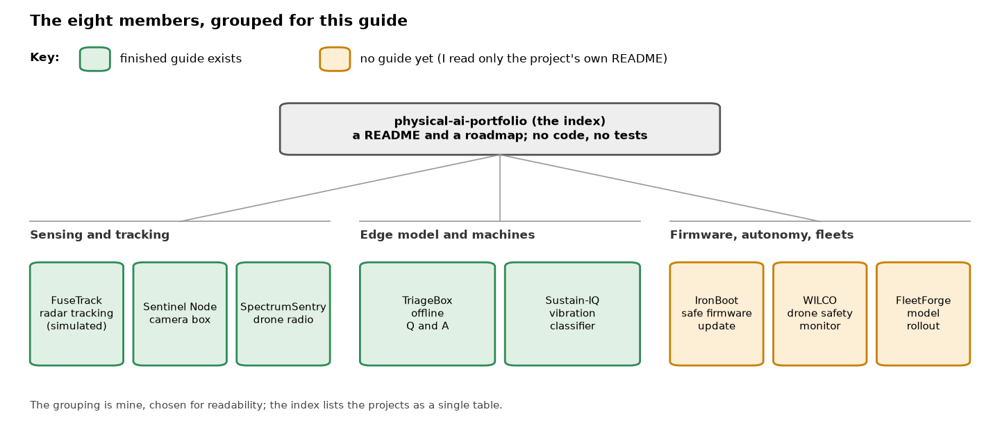
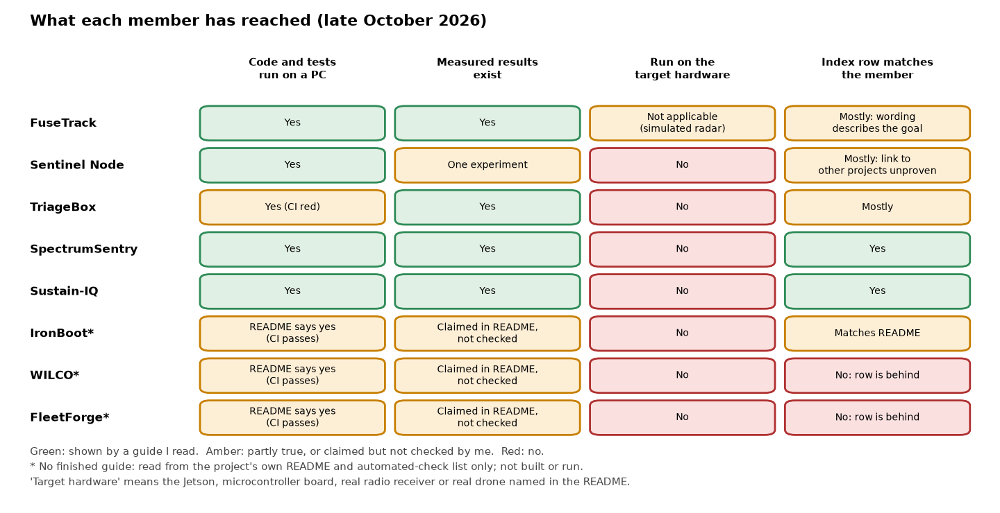

# physical-ai-portfolio

*A front-page repository that lists eight of my small projects about AI on physical machines and says how they fit together. It is only a map, and parts of it are out of date. The biggest gap: none of the eight has yet run on the real device it was built for. Every measurement so far was taken on a laptop or in a simulation.*

If you were handed a list of eight project names (radar tracking, a camera box, drone radio, firmware, fleets) and asked which are real, which are finished and which are only plans, you would want a map. That is the job of this repository. It is a front page: a README (the front-page text file of a repository) with a table of eight projects, a short roadmap, a security note and a licence. It holds no programs of its own. I call it "the index" in this guide.

The facts in two plain lines. It is public at https://github.com/PCSchmidt/physical-ai-portfolio under the MIT licence (a permissive open-source licence), and was last changed on 22 October 2026. It has no stars, no copies made by others and no outside users that I can show, and it has no automated checks (CI, continuous integration: a service that re-runs a project's tests on every change) because there is nothing to test.

AI coding agents wrote almost all of the code in the projects it lists, and I directed the scope, plans, architecture and preferences. The index text was also written with AI help: 14 of its 15 commits (saved changes) carry an AI co-author line.

On deterministic versus learned: the index itself is plain text, so it is fully deterministic and nothing in it is a model. The learned parts (software that learned patterns from examples) live in the projects it lists, and each of those is described in its own guide. Where chance enters, it is inside the members: simulated radar noise, small test sets and a language model's wording can all move a number by a few points. This guide does not repeat those limits; the member guides state them, and I point out below only where a small test set matters.

## Words used in this guide

A *guide* is a long plain-language write-up like this one. I wrote one for each of five of the eight projects, and the other three have none yet. A *member* is one of the eight projects the index lists. The eight are:

- FuseTrack: a Rust program that follows moving objects from noisy simulated radar.
- Sentinel Node: a test rig for a future camera sensor box that would spot things and report them on a small power budget.
- TriageBox: offline question answering with a small language model that must cite its source.
- SpectrumSentry: names a drone model from recorded radio signals and measures how that fails.
- Sustain-IQ: classifies machine vibration with a tiny model.
- IronBoot: safe update software for a microcontroller (a very small chip with kilobytes of memory). The update program is firmware, the code stored on the chip, and IronBoot is tested by cutting simulated power in the middle of an update on a simulated flash (the chip's storage memory).
- WILCO: a safety monitor that checks a language model's drone mission plans.
- FleetForge: rolls out signed model updates (digitally stamped to prove where they came from) to a fleet of devices in stages. A device agent is the small program on each device that applies an update; the control plane is the central program that decides which devices get it.

Two more names appear in the index's claims. A Jetson (the index names the Jetson Orin Nano) is a small NVIDIA computer built to run AI models next to a sensor. CoT (Cursor-on-Target) is a short text message format that mapping software such as ATAK (Android Team Awareness Kit, a shared map app) uses to show that something is at a place.

## The conclusion, and the main caveats

The index makes one big promise: each project will show "a model running on real hardware, inside a tested system, under a latency (delay) or power budget", with a measured headline result (the one number the project is known for) and an honest account of where it fails.

The honest half holds up. In the five projects with guides, each reports a headline measurement and then its limits, and several report results that went against the hope. The real-hardware half does not hold up yet. As of late October 2026, none of the eight has run on a Jetson, a microcontroller board, a real radio receiver or a real drone. The index says so in most of its table cells, but its opening sentence and its thesis read as if the hardware evidence already existed.

Three smaller things, each said once here. Two table rows are out of date: WILCO and FleetForge moved past their rows within hours of the index's last edit on 22 October, and much further by 23 October. Two of the three "how the pieces connect" claims are not borne out: only one project produces the shared CoT message, and no project uses the shared Jetson. And three members (IronBoot, WILCO, FleetForge) have no guide, so for them I read only each project's own README and list of automated checks; I built and ran nothing. The five guides describe their projects as they stood on 23 October (Sentinel Node as of 17 October); in those five repositories the only later commits, on 28 October, add the guides themselves.

## What kind of repository this is

Most repositories hold one project: code, tests, results. This one holds none of that. The nearest everyday comparison is the contents page of a book of short essays: it says what is in the book and the order the author meant you to read it, but it contains no essays, and if an essay is revised the contents page does not update itself.

That has a practical consequence. The index cannot be tested, so what it says can only be checked against the members. When a member changes, nothing forces the index to change with it. The roadmap says "status in the README is the source of truth", but in practice the members' own READMEs are more current, and where they disagree I treat the members as the better source.

Here is how each member stands, with the index's version beside what the member itself shows.

| Project | What the index says | What the member shows |
| --- | --- | --- |
| FuseTrack | Version 0.4; a more elaborate matching method built and measured, no better than the simple one | Mostly matches. One simulated radar only; no learned model; no CoT output, so the wording describes the goal |
| Sentinel Node | Scaffold plus one detector experiment; no device results | Mostly matches. Nothing has run on a Jetson; the CoT link to other projects is unproven |
| TriageBox | Measured on a laptop graphics card; no edge device | Mostly matches. Automated checks are failing, for a minor reason explained below |
| SpectrumSentry | Two public datasets, measured; nothing live | Matches |
| Sustain-IQ | First phase on a PC; nothing on a microcontroller | Matches |
| IronBoot | Tested on a simulated flash; nothing on a chip | Matches its README (no guide) |
| WILCO | "Nothing is flown by it yet"; no language model wired in | Out of date: its README now reports simulated flights (committed about five hours after the index's last edit) and a language model behind the monitor |
| FleetForge | "No device agent, control plane or real devices" | Out of date: its README now reports both, in simulation (the device agent was committed about 20 minutes after the index's last edit) |

## One row, followed through

The simplest way to see the gap is to follow one row. The index's WILCO row says nothing is flown by it yet and no language model is wired in. That was true when the row was written, at about midday UTC on 22 October. By that evening WILCO's own repository had a milestone in which 43 vetted drone missions were flown in a flight simulator (software that imitates a drone and its surroundings), and by 23 October a later one that places two local language models behind the monitor. A reader who stopped at the index would think WILCO was a sketch. A reader who clicked through would find a project that claims much more, though I have not built or run it, so I cannot say the claims are right. Either way, the index is the weaker source, and the same pattern explains the FleetForge row.

## What the index promises

The thesis says few machine-learning engineers can show a model on real hardware, inside a tested system, under a latency or power budget, and that "each project here is built to produce that evidence". The scope section sets firm limits: passive radio only (no transmitting, jamming or spoofing), defensive and sustainment work only (sensing, tracking, search, inspection and maintenance, with no weapons release or targeting code), public data only, and any real flight subject to the FAA (Federal Aviation Administration) Part 107 rules for small drones. The conventions say every project README follows one skeleton and that CI runs from the first commit.

The roadmap adds an order and rules: FuseTrack first, then Sentinel Node, TriageBox, SpectrumSentry or Sustain-IQ ("chosen based on target employers"), and IronBoot, WILCO and FleetForge "only after devices and models exist to build on". Each phase has a gate to pass before moving on; for Sentinel Node it is a detector running at 30 frames per second on the Jetson, with a table of delay and energy use at three power settings, and for TriageBox it is a benchmark across three ways of running the model. Neither gate has been met, and the guides present both as planned work. The rules say to finish and benchmark one project before starting the next, and to buy hardware only when its project is about to start. It also lists shared pieces to build once: a CoT writer, a benchmark harness for the Jetson, and a README and CI template.

## Where the claims hold up

How I checked: I read the index's README, roadmap, security note and commit history in a fresh copy that I did not change, then compared each statement with the finished guides, which carry their own checks. For the three members without guides I read only the README and the list of automated checks. I did not re-run any member's tests or recompute any member's numbers.

In the five projects with guides, the README gives a headline number first and has a limitations section, and the guides found the headline numbers matched the saved result files. The scope limits hold where the guides could check them: SpectrumSentry only reads recordings and has never been connected to a live radio, and FuseTrack contains tracking only. I did not check the three projects without guides for weapons, targeting or live-radio code, and the FAA sentence is a statement of intent that no project tests.

The guides report several negative results, each as the project's README states it. FuseTrack's guide reports that JPDA (Joint Probabilistic Data Association, a more elaborate way of deciding which radar blip belongs to which object) did not beat GNN (Global Nearest Neighbour, the simple method) in any scenario, and was worse in clutter (many false blips). Sustain-IQ's guide reports that a vibration classifier scoring 99.9% when test and training windows come from the same recordings scores 51.9% on a bearing fault size it never saw. TriageBox's guide reports that a small model wrongly answered 31 of 100 unanswerable questions, although a hand reading of those cases put the true rate of invented answers nearer 14 of 100 (one person did the labelling).

The index itself states status plainly ("Planned means nothing is built yet. Results appear only once measured"), and for five of the eight rows (FuseTrack, Sentinel Node, SpectrumSentry, Sustain-IQ and, by its README, IronBoot) the status matches the member, with TriageBox mostly matching, including "no device results".

## Where the claims do not hold up

Six disagreements matter. The table gives them; the sentences after it cover the smaller ones.

| What the index says | What the members show | Verdict |
| --- | --- | --- |
| The sensing projects publish detections as CoT, and FuseTrack consumes and emits the same format | Sentinel Node builds CoT messages. FuseTrack lists CoT output as planned. No CoT appears in SpectrumSentry's README, docs or guide | One of three projects |
| The Jetson used for Sentinel Node is reused for TriageBox and WILCO | No Jetson run exists for any project. Sentinel Node's guide says no Jetson code or device results are in its repository | Not yet true |
| Roadmap: finish and benchmark a project before starting the next | The five projects with guides were created on 16 and 17 October, IronBoot on 21 October, WILCO and FleetForge on 22 October. FuseTrack is still marked in progress | Not followed |
| Roadmap: IronBoot, WILCO and FleetForge only after devices and models exist | All three exist; nothing I read mentions a device being bought or used | Not followed |
| WILCO row: nothing flown, no language model | Its own README (23 October) reports 43 vetted missions flown in simulation (committed 22 October, about five hours after the index's last edit) and two local language models behind the monitor | Out of date |
| FleetForge row: no device agent, control plane or real devices | Its own README (23 October) reports a device agent (committed about 20 minutes after the index's last edit) and a staged-rollout control plane, both tested in simulation | Out of date |

Smaller ones. The opening phrase "multi-sensor fusion tracking" and FuseTrack's "learned vs. classical" describe the goal: FuseTrack uses one simulated radar, has no learned model, and its measured comparison is between two classical methods. The TriageBox row mentions a "distilled" (shrunk to copy a larger model) model and vision support; the guide shows neither, so that row describes a plan. The language lists for WILCO and FleetForge ("C++ / Python", "Go or Rust") do not match their Python source. I did not read WILCO's or FleetForge's code and reproduced none of their numbers, so whether their new claims hold is not known; the point is only that the row and the README disagree.

The TriageBox automated checks have failed on every run since a locked test set was added on 17 October, and were still failing on 28 October. The cause is a technical quirk in one test (a file check that trips over how Windows and Linux store line breaks), not a problem with the model results. The checks of the other four projects with guides are green.

## What the five projects with guides show

One short paragraph each, so a reader of the index need not open all five guides. The numbers come from those guides, which say how they were checked.

FuseTrack follows several simulated moving objects from simulated radar blips. The headline is a failure: a rule that confirms a track after three hits in five sweeps collapses when 200 false echoes arrive per sweep, giving about 156 metres of position error against 12 to 13 in good runs. A fix was tuned on the same scenarios it is scored on, and the simulator uses the same motion rules the filters assume, so the comparisons between methods mean something but the absolute numbers say little about real radar.

Sentinel Node is a laptop test rig for a future camera sensor box. Its one experiment uses the YOLO11n object detector (You Only Look Once, a family of fast detectors) on a public drone-imagery dataset. Storing the model's numbers as 8-bit whole numbers (INT8, instead of 16 or 32 bits) cost about 5% of the detector's score (0.162 on a 0-to-1 scale) and ran 8% to 27% faster on a laptop graphics card. The score is low, and the guide notes the project does not say how it compares with other models.

TriageBox answers questions about a set of documents with a small language model run locally, and refuses any reply that does not cite a passage it was shown. The check confirms the citation exists, not that it answers the question. On 200 benchmark questions the larger model answered 74 of 100 answerable ones correctly and wrongly answered 31 of 100 unanswerable ones. The project's own locked test is small (42 answerable and 18 unanswerable questions), so differences of a few points are not established. On that small test the larger model scored 90.5% right with 11.1% invented answers, a reminder that the same model looks better or worse depending on the test.

SpectrumSentry cuts recordings of ten consumer drones' radio links into short windows and names the drone model with a small neural network. The headline is the damage study: a network that reaches 97% on clean recordings falls to 21% when simulated noise reaches 10 dB (decibels, a measure of how loud the noise is compared with the signal). The recordings behind that result come from one anechoic chamber (a room that absorbs radio echoes) and one receiver; a second public set from another team is used only to check the method.

Sustain-IQ classifies bearing vibration from public recordings with a tiny model, and ships Rust inference code that reproduces the Python results exactly on its committed test inputs. Its guide stresses the gap between 99.9% when training and test windows are shuffled together and 51.9% when a whole bearing fault size is held back (kept out of training, then used only for testing). The microcontroller board is planned and nothing has run on it.

## Could the index be put into real use?

Only as a map. It is not software; "real use" means a reader (a recruiter, an interviewer, a collaborator) using it to find the right project. For that it works: the links point to the right repositories, six of the eight one-line statuses match or mostly match their projects, and the scope limits are stated up front. Nothing keeps it current, though, so for the detail of any one project its own guide and README are the better sources.

Three changes would close the gaps described above: bring the two out-of-date rows in line, rewrite "how the pieces connect" as a plan with a "built" or "not built" mark on each link, and add a "measured on" column (laptop, simulation, device) so the hardware gap shows in the table and not only in the cell text. A small check comparing each linked project's latest commit date with the index's own date would catch staleness automatically.

## How it was built, and who did what

The index was created on 16 October 2026 and last changed on 22 October. It has 15 commits, all in my name: an initial commit with the licence and a stub README, one commit that added the README, roadmap, security note and ignore file, and 13 small edits that add or refresh rows as each project appeared. AI coding agents wrote the text under my direction, as they did the code in the members.

The repository does not show why I chose this list of eight, why the roadmap is in this order, or why SpectrumSentry and Sustain-IQ were both built when the roadmap says to choose one, so I leave those unexplained.

## For recruiters and interviewers

What it shows: a stated scope (defensive and sustainment work, public data), and member projects that report a headline number and then limits, including negative results. What it does not show: any work on real devices, any customer or user, or any shared software across the projects, since each has its own code and the index has none.

## Where to look

- The index: its README has the table and links, the roadmap file has the order, gates and rules, and the security note says how to report problems. https://github.com/PCSchmidt/physical-ai-portfolio
- The five guides: [FuseTrack](fusetrack.md), [Sentinel Node](sentinel-node.md), [TriageBox](triagebox.md), [SpectrumSentry](spectrumsentry.md) and [Sustain-IQ](sustain-iq.md).
- The three projects without guides: IronBoot, WILCO and FleetForge, each linked from the index table.
